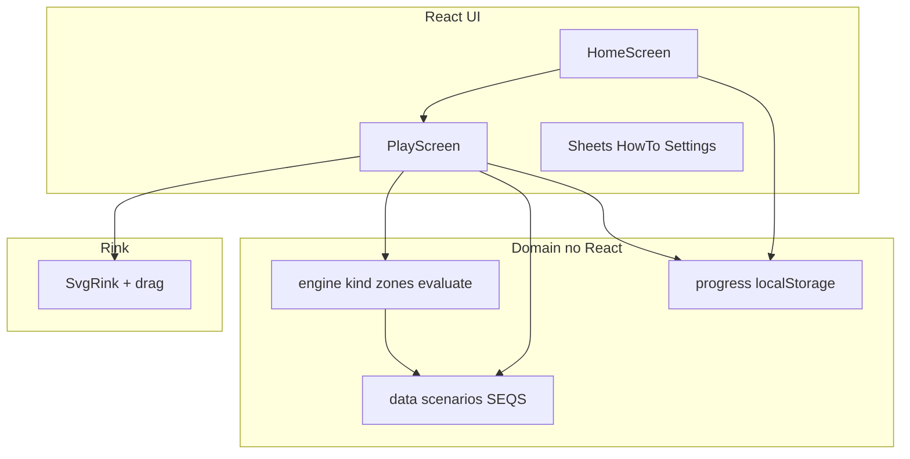

# Spec: Refactor Hockey Defence Trainer to Vite + React + TypeScript

Paired intent: `intent.md` (accepted). Status: accepted.

## 1. Problem restatement

单文件 PWA 将规则、关卡、渲染与模式流程耦合，阻碍加题与协作。目标是在**行为等价**前提下拆成可维护的 Vite + React + TypeScript 工程，并推送到 GitHub。

## 2. Requirements

### 2.1 Functional (must preserve)

| ID | Requirement |
| --- | --- |
| F1 | 模式：Home；Learn (Show Me)；Practice Help Me / Test Me；Game Challenge（含 Surprise Mix） |
| F2 | 解锁：后一档需前一档累计 `UNLOCK=5` 次合格通过；设置可 `unlockAll` |
| F3 | 进度持久化：`localStorage` key `hdt-progress-v1`（字段兼容现有：`passes`、`completed`、`learnIdx`、`game`、`unlockAll`、`sound`、`seenHow`） |
| F4 | 规则引擎数值与分支与基线一致：`kindOf` / `zonesFor`（含 lurker）/ `evaluate`（角色分配、danger、team flags、pass） |
| F5 | 关卡：11 个 `BASE` 场景 + 镜像；`LEARN_ORDER`；四套 `SEQS`；`randomSequence` 约束不变 |
| F6 | 冰场：SVG 绘制、横竖屏朝向、拖拽两名 D、区域/幽灵/箭头/反馈动画语义保持 |
| F7 | 文案：`GOOD_MSG` / `ROLE_TXT` / `fixMsg` / overall 文案逻辑保持（随机 pick 允许非确定，但分支条件不变） |
| F8 | 音效：Web Audio beep；可开关 |
| F9 | PWA：可安装；离线 cache-first；图标与 `theme_color` 保留 |

### 2.2 Non-functional

| ID | Requirement |
| --- | --- |
| N1 | TypeScript strict；纯函数引擎无 React 依赖，便于单测 |
| N2 | `npm run test` 与 `npm run build` 单入口、失败非零退出；**引擎相关用例必须全部自动跑通**（见 §3.4） |
| N3 | README：安装、开发、构建、如何加一道题、如何跑测试 |
| N4 | 移动优先触摸；**本期**不引入后端（见 §5 远期方向） |
| N5 | 按 SDLC 保留 `docs/` + `intent/refactor-vite-react/{intent,spec,plan}.md` |
| N6 | 新增/修改场景或规则时：先更新/补充失败测试再改实现（bugfix 禁改该失败断言） |

### 2.3 Non-goals（本期变更）

新玩法、改规则数值、SSR、视觉重设计。  
**账号登录、数据库持久化、在线排行榜** — 明确为远期能力（§5），**不在本次交付**；另开 `intent` 推进。

## 3. Design

### 3.1 Architecture



### 3.2 Proposed module map

| Path | Responsibility | Source baseline |
| --- | --- | --- |
| `src/engine/geometry.ts` | `clamp`, `ellD`, `grade`, `sideOf` | helpers |
| `src/engine/kind.ts` | `kindOf`, `carrierIdx` | ~427–440 |
| `src/engine/zones.ts` | `zonesFor` + lurker | ~443–473 |
| `src/engine/evaluate.ts` | `evaluate`, messaging helpers | ~477–585 |
| `src/data/scenarios.ts` | `BASE`, `mirror`, `SCN`, `LEARN_ORDER` | ~362–405 |
| `src/data/sequences.ts` | `SEQS`, `randomSequence` | ~406–421 |
| `src/state/progress.ts` | load/save/unlock；经 `ProgressStore` 接口，默认 `LocalStorageProgressStore` | ~310–322 |
| `src/rink/*` | SVG ice, players, zones, drag, orientation | rink section |
| `src/screens/Home.tsx` | ladder + mode entry | home |
| `src/screens/Play.tsx` | panel, modes, check flow | play |
| `src/audio/sfx.ts` | beep / SFX | ~325–343 |
| `src/styles/*` | 现有 CSS 变量与布局迁入 | `<style>` |
| `public/` | icons, apple-touch-icon | Game files |
| PWA | `vite-plugin-pwa`（cache-first，资产列表等价） | `sw.js` / manifest |

### 3.3 Data contracts（关键类型）

```ts
type Possession = 'us' | 'them';
type Kind = 'own' | 'rim' | 'deep' | 'carry' | 'out';
type Grade = 'good' | 'close' | 'off' | 'danger';

type Scenario = {
  id: string;
  name: string;
  has: Possession;
  puck: [number, number];
  us: [number, number][];
  them: [number, number][];
  why: string;
  side?: 1 | -1;
  threat?: 'rim';
};

type Zone = { cx: number; cy: number; rx: number; ry: number };
type DefPos = { x: number; y: number; moved?: boolean };
```

加题方式：在 `BASE` 增加一条场景（及可选 Learn/SEQ 引用）；镜像自动生成。

### 3.4 Test strategy（自证）

工具：**Vitest**。分层如下；标 `AUTO` 的必须在 CI/`npm test` 中通过；标 `MANUAL` 的在推送前人工勾选。

基线快照：从现有引擎生成 golden JSON，提交于 `src/engine/__fixtures__/`（容差：坐标绝对值 ≤ 1e-9，或显式 `toBeCloseTo`）。

#### 3.4.1 几何与分级 `AUTO`

| ID | Case | Expect |
| --- | --- | --- |
| T-GEO-01 | `clamp(5,0,1)` / `clamp(-1,0,1)` / `clamp(0.5,0,1)` | `1` / `0` / `0.5` |
| T-GEO-02 | 点在椭圆中心；点在边界；点在外 | `ellD` → `0` / `≈1` / `>1` |
| T-GEO-03 | `grade(1)` / `grade(1.8)` / `grade(1.81)` | `good` / `close` / `off` |
| T-GEO-04 | `sideOf`：无 `side` 且 `puck.y≥0`；`y<0`；显式 `side:±1` | `+1` / `-1` / 尊重显式值 |

#### 3.4.2 局面分类 `kindOf` `AUTO`

| ID | Case | Expect |
| --- | --- | --- |
| T-KIND-01 | `has:'us'`（任意 puck） | `own` |
| T-KIND-02 | `has:'them'`, `threat:'rim'` | `rim`（优先于深度） |
| T-KIND-03 | `has:'them'`, `puck.x>45`（无 rim） | `deep` |
| T-KIND-04 | `has:'them'`, `8 < puck.x ≤ 45` | `carry` |
| T-KIND-05 | `has:'them'`, `puck.x ≤ 8` | `out` |
| T-KIND-06 | 全部 11×2（`BASE`+镜像）场景 | `kindOf` 与 golden 一致 |

#### 3.4.3 目标区 `zonesFor` `AUTO`

| ID | Case | Expect |
| --- | --- | --- |
| T-ZONE-01 | 每种 `kind` 至少 1 个代表场景 | `S`/`W` 的 `cx,cy,rx,ry` 匹配 golden |
| T-ZONE-02 | `own` 下浅区 vs 深区 puck（验证 `δ`） | 深区 `S.cx`/`W.cx` 更大（与公式一致） |
| T-ZONE-03 | `carry` / `out` 的 `clamp` 边界 puck | 中心落在公式 clamp 区间内 |
| T-ZONE-04 | 含 lurker 的场景（如 `sneak`） | `W` 被修正；`lurker` 非空且取最小 `o_x` |
| T-ZONE-05 | 无偷跑对手 | `lurker === null`，`W` 为默认 |
| T-ZONE-06 | 镜像场景 | `S.cy`/`W.cy`（及 lurker.y）相对原场景符号翻转；`cx/rx/ry` 不变 |

#### 3.4.4 评分 `evaluate` `AUTO`

| ID | Case | Expect |
| --- | --- | --- |
| T-EVAL-01 | 两名 D 互换位置：优解在 D0 球侧 vs D1 球侧 | `si`/`wi` 随成本 `A/B` 翻转；`pass`/`allGood` 不变 |
| T-EVAL-02 | 两人都在各自椭圆内 | 两人 `g:'good'`，`allGood`，`pass` |
| T-EVAL-03 | 一人 good、一人 `1<d≤1.8` | `close`；`pass===true`；`allGood===false` |
| T-EVAL-04 | 一人 `d>1.8` 且无 danger | `off`；`pass===false` |
| T-EVAL-05 | 对方控球且 D 比 puck 更深 `x > puck.x+3` | 该 D `danger:'deep'`，`g:'danger'`（仅当原非 good） |
| T-EVAL-06 | 对方控球、中路角色 `x>20` | `danger:'deep'` |
| T-EVAL-07 | 我方控球、中路角色 `x>40` | `danger:'tooDeep'` |
| T-EVAL-08 | 进攻区内无人守球侧板墙通道 | 球侧角色 `danger:'boards'`（条件满足时） |
| T-EVAL-09 | 对方控球、中路无人门前侧 | 中路角色 `danger:'middle'` |
| T-EVAL-10 | 已 `good` 的 D | **不会**被改成 danger |
| T-EVAL-11 | 两人同侧 / 间距 `<10` / 对方控球两人都 `x>22` | `team` 含 `same` / `close` / `bothDeep` |
| T-EVAL-12 | 每个 `BASE` id（及镜像）一组「正确站位」D 坐标（来自 golden） | `allGood===true` |
| T-EVAL-13 | 同上场景一组明显错误站位 | `pass===false` 或存在非 good |

#### 3.4.5 关卡数据与序列 `AUTO`

| ID | Case | Expect |
| --- | --- | --- |
| T-DATA-01 | `BASE.length === 11`；每个 id 唯一 | 通过 |
| T-DATA-02 | `mirror(sc).puck/us/them` y 取反；`id` 后缀 `_m`；`side` 翻转 | 通过 |
| T-DATA-03 | `LEARN_ORDER` 每项存在于 `SCN` | 通过 |
| T-DATA-04 | 固定三条 `SEQS` 的 `steps` 均可 `getScn` | 通过 |
| T-DATA-05 | `randomSequence`（mock random）：长度 6、无同 id 左右重复对、控球切换 2–4 次、首题 `has==='us'` | 通过 |
| T-DATA-06 | 穷尽失败时回退 `SEQS[0].steps` | 行为与基线一致 |

#### 3.4.6 进度解锁 `AUTO`

| ID | Case | Expect |
| --- | --- | --- |
| T-PROG-01 | 默认 progress 形状 | 与 `defaultProg()` 一致 |
| T-PROG-02 | `unlocked(1)` 恒 true；`passes[1]<5` 时 level 2 锁；`≥5` 解锁 | 通过 |
| T-PROG-03 | `unlockAll:true` 时全部解锁 | 通过 |
| T-PROG-04 | save → load 往返 | JSON 等价 |
| T-PROG-05 | 损坏 / 非法 JSON | 回退 default，不抛未捕获异常 |

#### 3.4.7 坐标/朝向纯函数 `AUTO`（若抽出）

| ID | Case | Expect |
| --- | --- | --- |
| T-RINK-01 | `clampToIce` 边界外点 | 夹回冰面合法范围 |
| T-RINK-02 | 横屏 / 竖屏 `toRink` 往返或已知样点 | 与 golden 一致 |

#### 3.4.8 构建与冒烟

| ID | 层 | Case |
| --- | --- | --- |
| T-BUILD-01 | `AUTO` | `npm run test` 全绿 |
| T-BUILD-02 | `AUTO` | `npm run build` 成功 |
| T-UI-01 | `MANUAL` | Learn 至少 1 关演示完整 |
| T-UI-02 | `MANUAL` | Practice：拖到绿区通过；故意危险位出红/文案 |
| T-UI-03 | `MANUAL` | Game 固定序列跑完出星级 |
| T-UI-04 | `MANUAL` | 刷新后进度仍在 |
| T-UI-05 | `MANUAL` | 竖屏可拖拽打分 |
| T-UI-06 | `MANUAL` | manifest / 安装相关 meta 存在；生产预览可打开 |

#### 3.4.9 Done 标准（对应工作流 G4）

- 全部 `AUTO` 用例通过，输出可贴进会话/PR。
- `MANUAL` 清单勾选完成（或注明豁免原因）。
- 无验证证据不得报完成。

### 3.5 Deploy

- 首次将工程推送到 `origin/main`（远程当前为空）。
- 静态托管后续可选（Vercel/GitHub Pages）；本次门禁为 **GitHub 上可 clone 可 build**。

## 4. Areas of concern

| Concern | Mitigation |
| --- | --- |
| 随机文案 / `randomSequence` 导致 flaky 测试 | 单测注入 `Math.random` 或只断言非随机字段；序列函数用固定 seed 替身 |
| PWA SW 与 Vite 哈希资源 | 使用 `vite-plugin-pwa` 生成预缓存列表，验收 offline 基本可用 |
| 拖拽与竖屏旋转坐标易回归 | 保留 `toRink` / `applyOrientation` 纯函数并抽测；UI 冒烟必测竖屏 |
| 进度 key 变更会丢用户数据 | **禁止**改 `hdt-progress-v1` 结构语义；仅允许向后兼容扩展字段 |
| 远期要上 DB / 登录 / 排行榜 | 本期用 `ProgressStore` 抽象隔离存储；UI 不直读 `localStorage`；引擎与关卡保持无鉴权依赖，避免日后难拆 |

## 5. Open questions

远期产品方向（**结转，不阻塞本期 G2**；落地时各开新 intent）：

| ID | 方向 | 对本期的含义 | 未决（留给未来 intent） |
| --- | --- | --- | --- |
| OQ-1 | **数据库存储**进度/成绩 | 本期仅 `localStorage`；代码经 `ProgressStore` 接口，便于日后换 `ApiProgressStore` | 选型（如 Postgres/Supabase）、同步冲突（多设备）、离线优先策略 |
| OQ-2 | **排行榜** | 本期不实现 UI/API；评分结果结构保持可序列化，便于日后上报 | 排行维度（关卡星级/通关数/用时）、防作弊、是否公开 |
| OQ-3 | **用户登录与账号管理** | 本期无鉴权；PWA 仍可匿名使用 | Auth 方案（Clerk/Auth0/自建）、未成年人/教练组织账号、与 PWA 离线的关系 |

本期验收仍以 F1–F9 行为等价 + §3.4 测试为准；OQ-1…3 不纳入本次 Done。

## 6. Acceptance checklist（G2）

- [ ] 解决 intent 陈述的问题（可维护拆分 + TS 组件化）
- [ ] F1–F9 / N1–N6 完整且无与 non-goals 冲突
- [ ] §3.4 测试用例表（T-GEO … T-UI）完整可执行
- [ ] concerns 有 mitigation
- [ ] PO 接受本 spec → 进入 Build `plan.md`
