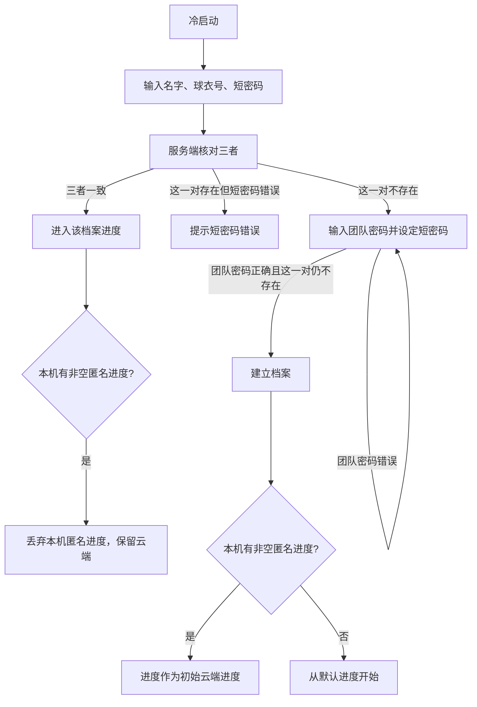

# Spec: 按球员身份记住进度

Paired intent: `intent.md` (accepted). Status: accepted.

## 1. Problem restatement

每次重新打开游戏都要输入写死的团队密码，进度也不是按球员分开的。本变更改成：用 nickname、球衣号和短密码认出球员，进入这个人自己的进度。团队密码只用于新建档案。

数据库用 Supabase 项目 `lxwyjdlepsntcosczors`（`https://lxwyjdlepsntcosczors.supabase.co`）。服务端代码放在本仓库，由它连接这个项目。浏览器不直接持有能改任意档案的密钥。接受本 spec 之后才写 `plan.md`；`plan.md` 被接受之前不改实现代码。

## 2. Requirements

### 2.1 Functional

| ID | Requirement |
| --- | --- |
| F1 | 每次冷启动都先进入身份门。要输入 nickname、球衣号、短密码。不把「已解锁」记在 `sessionStorage` 里跨次免输。 |
| F2 | 三者与同一份已有档案一致时，进入该档案的进度，不再要团队密码。 |
| F3 | 名字加球衣号这一对还不存在时，不能进入。改为输入团队密码；通过后用这一对新建档案，并设定短密码。 |
| F4 | 名字加球衣号已经存在、但短密码不对时，停在身份门并提示短密码错误。不得打开新建流程，也不得另建一份同名同号档案。 |
| F5 | 唯一身份是规范化后的 nickname 加球衣号。同一球衣号可以有多份档案，只要名字不同。 |
| F6 | 团队密码只在新建档案时核对，而且只在服务端核对。前端源码、打包结果和浏览器存储里都不得出现能单独放行的团队密码。现有 `APP_PASSWORD` 在实现本变更时从客户端移除。 |
| F7 | 短密码只在服务端以慢哈希保存。接口响应、日志和浏览器存储里不出现短密码原文。 |
| F8 | 进度仍使用现有字段：`passes`、`completed`、`learnIdx`、`game`、`unlockAll`、`sound`、`seenHow`。读写都挂在已登录的 profile 上。Learn / Practice / Game 的流程和解锁条件不变，仍是前一档累计 5 次合格。 |
| F9 | 本机 `hdt-progress-v1` 若不是空进度：这一对身份还不存在时，新建档案并把这份进度作为初始云端进度。这一对已经存在时，短密码通过后进入已有档案，保留云端进度，不上传、不覆盖。空进度不提示迁移。 |
| F10 | 同一次打开里可以换球员。换球员清除本次会话，回到身份门。下一次冷启动仍然要重新输入三者。 |
| F11 | 身份门在没有网络时不能登录或建档，并说明需要网络。登录成功之后，对局中的单次保存失败不打断当前这一下；进度留在本地队列，恢复网络后再提交。用户回到首页时，若队列仍未提交，要看见「进度还没保存到你的档案」。 |

### 2.2 Non-functional

| ID | Requirement |
| --- | --- |
| N1 | 不改 `kindOf`、`zonesFor`、`evaluate` 及关卡数据。 |
| N2 | 规范化、空进度判断、迁移取舍做成纯函数，并有自动化测试。`npm test` 通过后才算完成。 |
| N3 | 新建接口对团队密码错误做次数限制。登录接口对同一对名字和球衣号的短密码错误做次数限制。限制的具体阈值写进实现计划，不在本 spec 绑定厂商。 |
| N4 | 儿童可操作：身份门主按钮高度不低于 44px。竖屏验收视口上，键盘未弹出时，三个输入框和主按钮同时可见。 |
| N5 | 文案用球员能懂的短句。不出现 token、hash、API 等实现词。 |

### 2.3 Identity rules

| 字段 | 规则 |
| --- | --- |
| Nickname | 去掉首尾空格，连续空格并成一个。比较时忽略大小写。档案显示第一次建档时的写法。长度 1–20。允许字母、数字、空格、撇号和连字符。 |
| 球衣号 | 整数 0–99。`07` 与 `7` 是同一个号。 |
| 短密码 | 恰好 4 位数字。每次冷启动都要输入。不与团队密码相同。 |
| 团队密码 | 仍是现有那一串，只存在于服务端。 |

### 2.4 Non-goals

排行榜、邮箱或短信登录、第三方账号、本 spec 选定服务器厂商、修改关卡和规则数值、重做视觉品牌。

## 3. Design

### 3.1 Entry flow

登录成功之后才加载游戏。换球员回到 `form`，不保留上一位的会话。

### 3.2 Server contract

登录、新建和保存由本仓库的服务端完成。数据存在 Supabase 项目 `https://lxwyjdlepsntcosczors.supabase.co`。浏览器不使用该项目的 `service_role` 密钥。

| 动作 | 输入 | 结果 |
| --- | --- | --- |
| 登录 | nickname、球衣号、短密码 | 成功：会话和该档案进度。这一对存在但短密码错误：失败，且与「这一对不存在」区分开。这一对不存在：失败，客户端改走新建。 |
| 新建 | nickname、球衣号、新短密码、团队密码、可选初始进度 | 成功：会话和进度。团队密码错误：不建档。这一对已存在：不建档，不覆盖原进度。 |
| 保存进度 | 会话、进度 | 成功后云端与本次会话一致。会话无效则拒绝。 |

会话只放在内存里。关闭页面或换球员后失效。进度响应不得带出短密码或团队密码。

「这一对已存在但短密码错误」和「这一对不存在」必须能被客户端区分。这会让知道名字和球衣号的人发现档案已经存在。这是 F3 与 F4 两条不同画面所要求的，接受本 spec 即接受这一点。

### 3.3 Local progress

`hdt-progress-v1` 继续只代表迁移前的匿名进度。

空进度的定义：`passes` 全是 0，`completed` 是 0，`learnIdx` 是 0，`game` 为空，`unlockAll` 为 false。只改过 `sound` 或 `seenHow` 仍算空进度。

迁移成功或明确丢弃之后，删掉这份匿名记录，避免下次冷启动再问一次。

游戏进行中的保存改走「当前会话的进度接口」。`LocalStorageProgressStore` 只做 F11 的未提交队列，不再是进度的权威来源。

### 3.4 Files

本表是接受后的 `plan.md` 要落的范围。规格未被接受前，不改这些文件。

| Path | Change |
| --- | --- |
| `src/auth/gate.ts` | 去掉客户端里的团队密码和 `sessionStorage` 解锁。改为身份规范化与登录结果判断的纯函数。 |
| `src/screens/PasswordGate.tsx` | 改为名字、球衣号、短密码，以及新建档案所需的团队密码。 |
| `src/state/progress.ts` | 增加空进度判断、迁移取舍。不改现有字段含义。 |
| `src/state/ProgressStore.ts` | 会话内的读取、保存、未提交队列。 |
| `src/screens/gameController.ts` | 保存与设置里的「换球员」。不改关卡流程。 |
| `server/` | 本仓库内的登录、新建、保存、哈希与次数限制。用服务端密钥连接上面的 Supabase 项目。密钥和团队密码只放在环境变量，不写进仓库。 |

### 3.5 Test strategy

`AUTO`，不依赖真实服务器：

| ID | 检查 |
| --- | --- |
| T-ID-01 | `Sam` 与 `sam`、`07` 与 `7` 规范化后是同一身份 |
| T-ID-02 | 空名字、超过 20 字、球衣号 100、短密码不是 4 位数字，都拒绝 |
| T-ID-03 | 空进度为 true；只有 `seenHow` 或 `sound` 变化仍为空；`passes[1] > 0` 不为空 |
| T-ID-04 | 这一对不存在且本机进度非空：初始进度用本机记录 |
| T-ID-05 | 这一对已存在：结果是保留云端进度，本机匿名进度不上传 |
| T-ID-06 | 现有 `npm test` 仍通过，规则引擎用例不改断言 |

`MANUAL`，服务端选定并实现之后才执行：

| ID | 检查 |
| --- | --- |
| T-UI-01 | 冷启动要三者；关掉再开仍要三者 |
| T-UI-02 | 短密码错误时不出现团队密码框 |
| T-UI-03 | 新的一对要团队密码；错误密码不建档 |
| T-UI-04 | 同号不同名可以建成第二份，进度互不影响 |
| T-UI-05 | 本机有进度且云端已有这一对：进入后看到的是云端进度 |
| T-UI-06 | 换球员后看到身份门，上一位的进度不留在画面上 |
| T-UI-07 | iPhone SE 竖屏 375×667，键盘未弹出时三个输入框和主按钮都在视口内 |

Done（G4）需要 T-ID-01…06 的命令输出，以及 T-UI-01…07 的核对记录。服务端未实现时，不得把本变更报为完成。

## 4. Areas of concern

| Concern | Mitigation |
| --- | --- |
| 团队密码目前写在 `src/auth/gate.ts` | F6。实现时从客户端删除，改为服务端环境变量。在那之前不把登录做成「前端自己比对密码」。 |
| Supabase 的 `service_role` 密钥可以绕过行级权限 | 只放在本仓库服务端的环境变量里。浏览器只调用本仓库的登录、新建和保存接口。项目 URL 可以写在规格里，密钥不写。 |
| 区分「没有这对档案」和「短密码错误」会暴露档案是否存在 | 接受。F4 禁止借这条信息去覆盖原档案。次数限制见 N3。 |
| 打错一个字母会建成另一份进度 | 身份门在新建前展示将要使用的名字和球衣号。不提供合并两份档案。 |
| 球场没网 | F11。登录本身必须在线；登录后的对局允许排队保存。 |
| 短密码是 4 位数字，队友看见输入就可能记住 | 这是已接受的短密码方案。不在本变更里改成更长的密码。输入框使用密码遮罩。 |
| 孩子的名字进入数据库 | 只保存 nickname 和球衣号。不做名单页，不做排行榜。 |

## 5. Open questions

无。数据库和代码位置已经定为：

- 数据库：Supabase 项目 `https://lxwyjdlepsntcosczors.supabase.co`
- 服务端代码：本仓库的 `server/`，由服务端连接该项目

§2.3 的 4 位短密码、忽略大小写、以及换球员按钮，仍是本 spec 为了可实现而写下的规则；不同意就退回本 spec。

## 6. Acceptance checklist（G2）

- [x] 解决已接受 intent：按名字、球衣号、短密码进入个人进度；团队密码只用于新建
- [x] F1–F11 与已接受的 Decisions 一致
- [x] 数据库定为该 Supabase 项目，服务端代码在本仓库，密钥不进仓库
- [x] §3.5 的自动测试不需要真实服务器
- [x] 发起人已接受本 spec。下一步写 `plan.md`；`plan.md` 被接受之前不改实现代码
